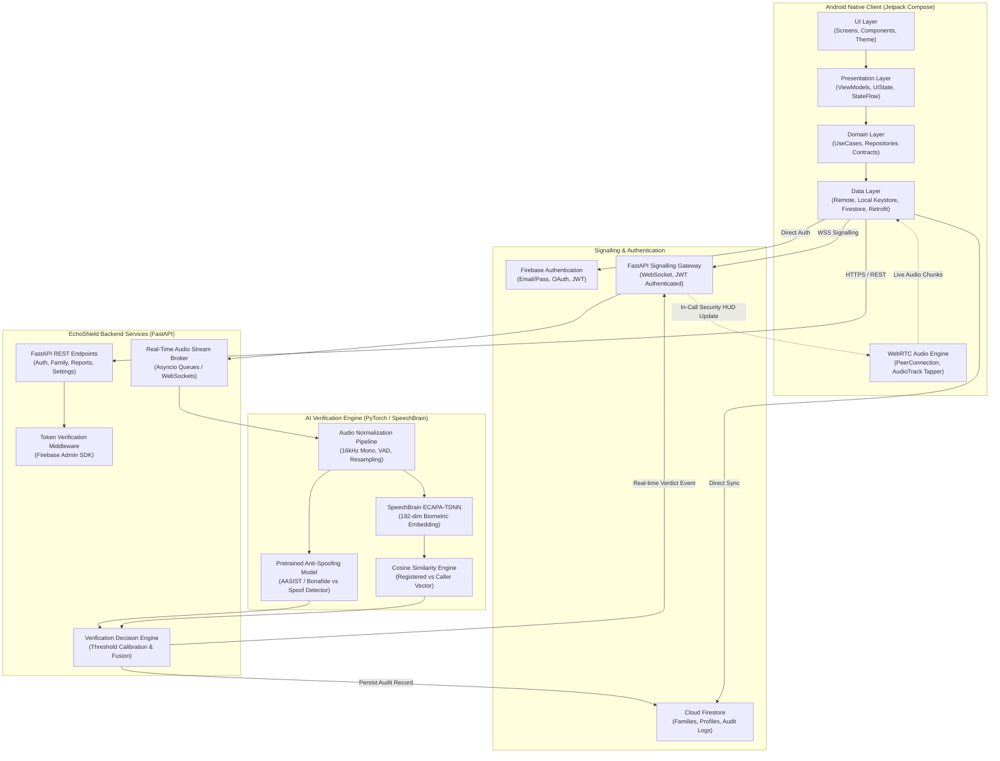
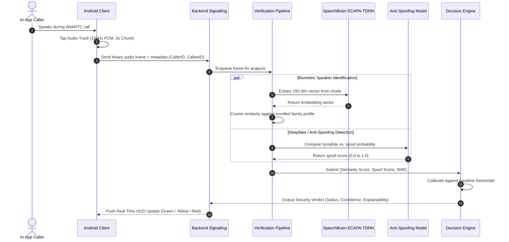

# EchoShield Architecture Specification

## 1. System Overview & Vision

**EchoShield** is an end-to-end native Android application and secure AI-powered verification ecosystem designed to protect families against voice cloning scams, deepfakes, and synthetic impersonation attacks. EchoShield enables family members to place encrypted in-app voice calls, continuously analyzing the incoming caller's voice stream against consent-registered biometric profiles and state-of-the-art anti-spoofing neural networks in real time.

### Core Architectural Principles
- **No Synthetic Shortcuts**: Verification is backed by real, deterministic machine learning models (SpeechBrain ECAPA-TDNN and pretrained Anti-Spoofing models). No random scores or simulated heuristics.
- **Privacy & Biometric Consent First**: Informed consent is required prior to enrollment and real-time analysis. Call participants are always visually and audibly notified. Raw call audio is processed ephemerally in RAM and purged immediately post-inference; only encrypted biometric embeddings and forensic verification audit trails are retained.
- **In-App Encrypted Calling Only**: Verification operates exclusively over EchoShield WebRTC peer-to-peer calls. The system does not attempt or permit SIM/cellular call tapping (compliant with Android security sandboxing and telecommunication privacy laws).
- **Zero Secrets in Client**: Firebase service account credentials and backend master keys remain strictly within secure backend environments. Client-side authentication leverages short-lived Firebase ID tokens.

---

## 2. High-Level System Architecture



---

## 3. Android Client Architecture

The Android application follows **Clean Architecture** and **MVVM** principles with unidirectional data flow (UDF).

```
android-app/app/src/main/java/com/echoshield/
├── core/
│   ├── network/          # Retrofit, OkHttp, Authenticator, Interceptors
│   ├── security/         # EncryptedSharedPreferences, Android Keystore, CryptoUtils
│   ├── audio/            # AudioRecord wrapper, PCM formatters, VAD detectors
│   ├── permissions/      # Runtime permission orchestrator (Record Audio, Camera, Notification)
│   └── util/             # Coroutine dispatchers, Result wrappers, Extensions
├── navigation/           # Compose Destination, NavHost, Safe Arguments
├── theme/                # Material 3 Color Schemes, Typography, Shapes, Dynamic Theming
├── authentication/       # Login, Register, Password Reset, MFA UI & ViewModels
├── dashboard/            # Home Feed, Security Status, Quick Actions UI & ViewModels
├── family/               # Family Group Management, Invites, Member Permissions UI & ViewModels
├── voice/                # Consent-based Voice Enrollment, Audio Recorder UI & ViewModels
├── calling/              # WebRTC In-Call Screen, Signalling Client, HUD Status Overlay
├── verification/         # Live Verification Banner, Real-time Trust Gauge, Risk Alerts
├── reports/              # Call Verification History, Forensic Analysis Details UI & ViewModels
├── notifications/        # Push Notifications (FCM), High-priority Security Call Alerts
├── settings/             # Biometric Data Controls, Consent Revocation, Purge Requests
├── data/
│   ├── local/            # Biometric cache, Keystore tokens
│   ├── remote/           # Firebase SDK, Retrofit API Services, WebSocket Client
│   ├── mapper/           # DTO to Domain Entity converters
│   └── repository/       # Concrete Repository Implementations
└── domain/
    ├── model/            # Immutable Domain Entities
    ├── repository/       # Repository Interfaces
    └── usecase/          # Single-purpose Business UseCases
```

### Unidirectional Data Flow (UDF)
1. **Events**: UI components emit immutable `UiEvent` sealed classes (e.g., `EnrollmentEvent.RecordSampleClicked`).
2. **ViewModel**: Interacts with `Domain UseCases`, updates private `MutableStateFlow<UiState>`, and exposes public immutable `StateFlow<UiState>`.
3. **One-Time Effects**: Handled via `Channel<UiEffect>` and exposed as `Flow<UiEffect>` for navigation, Snackbars, and dialog triggers.
4. **State Rendering**: Jetpack Compose Composables react purely to state changes without retaining internal business state.

---

## 4. Backend Architecture (FastAPI)

The backend is built with Python 3.13 and FastAPI, structured modularly to isolate domain concerns:

```
backend/app/
├── main.py               # Application factory, CORS, Lifespan hooks
├── core/
│   ├── config.py         # Pydantic v2 Settings (environment-based)
│   ├── security.py       # Firebase Token Verifier, AES-GCM vector decryptor
│   └── logging.py        # Structured JSON logging for auditability
├── auth/                 # Auth verification router & dependency injection
├── users/                # User profile management and preferences
├── family/               # Family circle CRUD, invite tokens, member roles
├── enrollment/           # Voice registration endpoints & consent logging
├── speaker/              # ECAPA-TDNN feature extraction service
├── antispoof/            # Audio anti-spoofing inference service
├── calling/              # WebRTC WebSocket signalling & room management
├── verification/         # Verification orchestration and fusion pipeline
├── reports/              # Historical verification records & export endpoints
└── common/               # Shared Pydantic schemas, exceptions, constants
```

---

## 5. AI Verification Engine Architecture

Verification executes a **Dual-Engine Pipeline** combining Speaker Verification with Synthetic Audio Spoof Detection.



### Models & Metrics
1. **Speaker Recognition Model**: `speechbrain/spkrec-ecapa-voxceleb`
   - Model Architecture: Emphasized Channel Attention, Propagation and Aggregation Time Delay Neural Network (ECAPA-TDNN).
   - Representation: 192-dimensional latent embedding vector.
   - Comparison: Cosine similarity $S_{cos}(v_1, v_2) = \frac{v_1 \cdot v_2}{\|v_1\| \|v_2\|} \in [-1, 1]$, normalized to $[0, 1]$.
2. **Anti-Spoofing Model**: AASIST / Pretrained Bonafide vs. Spoof Classifier
   - Target Artifacts: Text-to-Speech (TTS), Voice Conversion (VC), neural vocoder artifacts, replay room impulse signatures.
   - Output: Probability distribution over `Bonafide` vs. `Spoof`.
3. **Combined Decision Matrix**:
   - **AUTHENTIC** (Green): Speaker Similarity $\ge \tau_{match}$ ($0.75$) AND Spoof Probability $\le \tau_{spoof}$ ($0.20$).
   - **UNVERIFIED_CALLER** (Yellow): Speaker Similarity $< \tau_{match}$ ($0.75$) AND Spoof Probability $\le \tau_{spoof}$ ($0.20$). Caller sounds natural, but does not match registered family voice.
   - **SUSPICIOUS_ANOMALY** (Amber): Spoof Probability between $0.20$ and $0.60$ or high background acoustic anomalies.
   - **DEEPFAKE_DETECTED** (Red): Spoof Probability $> 0.60$. Synthetic or cloned voice characteristics detected. High urgency alarm triggered on screen.

---

## 6. Real-Time WebRTC Calling & Signalling

- **Peer-to-Peer Transmission**: Low-latency SRTP (Secure Real-time Transport Protocol) between devices.
- **Signalling Server**: Authenticated WebSockets over TLS (`wss://`).
- **Audio Extraction**: WebRTC `AudioTrack` tapped on Android using a non-blocking `AudioRecord` / sink interface, feeding 16kHz 16-bit mono PCM chunks into the verification engine without interrupting the audio playback pipeline.
- **No Cellular SIM Tapping**: Audio is sourced strictly from the in-app WebRTC session. SIM calls are not intercepted.

---

## 7. Security, Biometric Privacy & Compliance

| Requirement | Implementation Strategy |
| :--- | :--- |
| **Informed Consent** | Interactive enrollment screen with explicit biometric consent checkbox, signed audit log stored in Firestore with timestamp and user ID. |
| **No Silent Recording** | Persistent Android foreground notification and animated in-call banner: "EchoShield Active: Voice Verification Enabled". |
| **Biometric Protection** | Raw audio enrollment clips are converted to mathematical embedding vectors (192 floats) and discarded from disk. Stored vectors are encrypted using AES-256-GCM. |
| **Data Retention** | Call verification audio chunks are held only in RAM during inference (max 5 seconds buffer) and immediately deallocated. |
| **Secret Management** | Client contains zero backend keys. Google Services config uses restricted Android API keys. Firebase Admin SDK service account key is loaded via backend environment variables only. |
| **Biometric Deletion** | "Purge Biometric Profile" in Settings immediately deletes the encrypted vector from Firestore and invalidates all local cached hashes. |

---

## 8. Firestore Data Architecture

- `/users/{userId}`: User details, familyId, role (`admin` | `member`), fcmToken, createdAt.
- `/families/{familyId}`: Family name, inviteCode, adminUserId, createdAt.
- `/enrollments/{userId}`: Consent record, enrollmentStatus (`pending` | `completed`), encryptedEmbedding, vectorIv, modelVersion, updatedAt.
- `/verifications/{callId}`: CallerId, calleeId, familyId, timestamp, durationSeconds, overallVerdict, minSimilarityScore, maxSpoofScore, forensicBreakdown.

